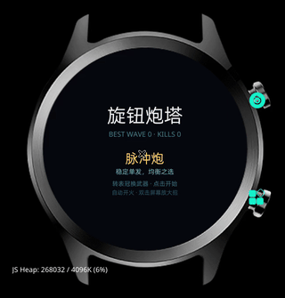
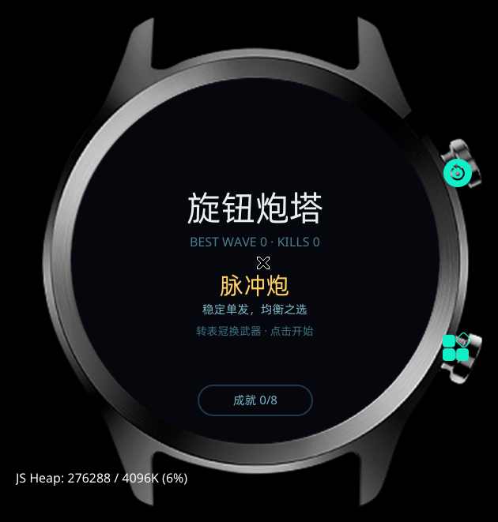
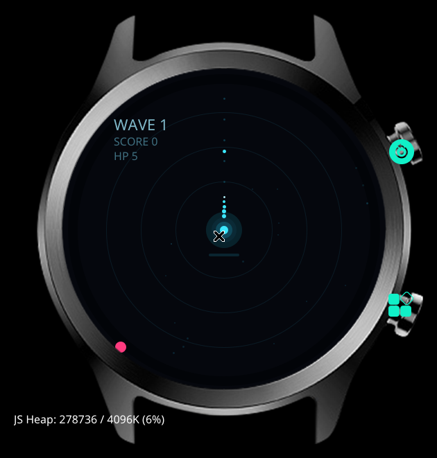
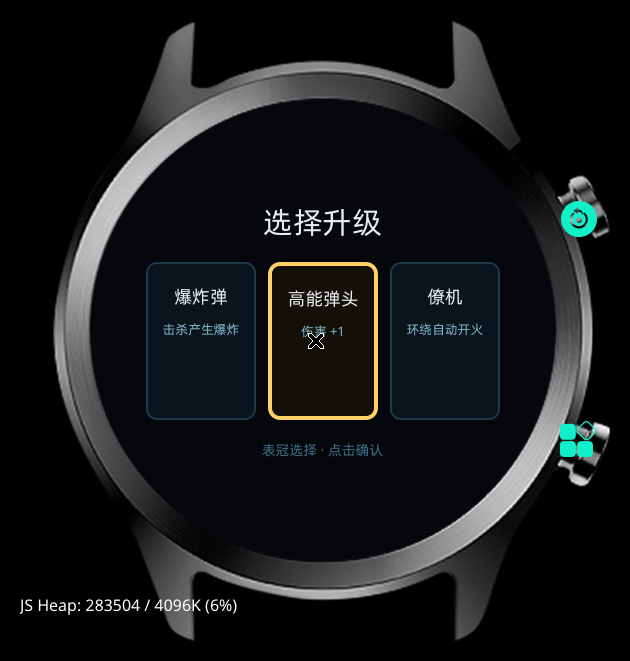
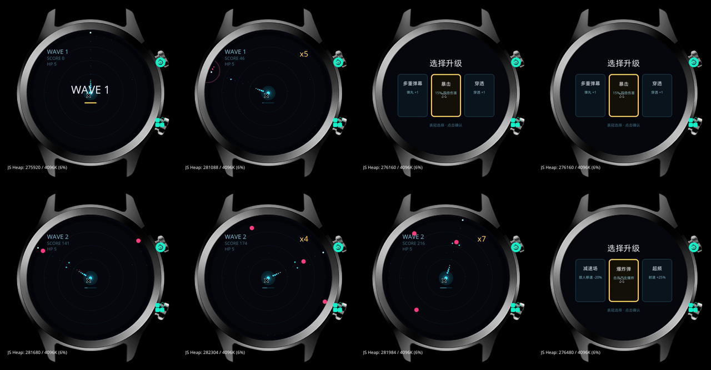

# 旋钮炮塔

> 为 **OPPO Watch S** 的圆屏和旋转表冠做的肉鸽塔防。
> 转表冠瞄准，炮塔自动开火，双击屏幕放大招。10 关 + 无尽，一局 2~4 分钟。

-0a7ea4?style=flat-square)
-6b5a33?style=flat-square)




> 真机 div 渲染实录。演示视频：[演示.mp4](预览/旋钮炮塔/演示.mp4)

---

## 为什么是这块表

| 硬件 | 怎么用 |
|---|---|
| **旋转表冠** | 模拟量瞄准，不是四方向键；转多快炮塔转多快 |
| **466×466 圆屏** | 360° 环形战场，敌人从任意方向进场 |
| **触摸屏** | 只负责“开始 / 确认 / 双击大招”，不承担高频操作 |
| **无 Wi-Fi** | 纯单机，不需要网络 |

设计上刻意做了两个取舍：

1. **自动开火**。手表上一直戳屏幕又累又挡视野，把操作收敛到“只瞄准”。
2. **双击放大招**。不占画面、不需要额外按钮；表冠按压也绑定了同一个动作。

---

## 操作

| 操作 | 作用 |
|---|---|
| 转表冠 | 瞄准；菜单里换武器；升级界面选卡 |
| 自动开火 | 有敌人且冷却结束即射击 |
| 双击屏幕 | 放大招（充能满时） |
| 表冠按压 | 同样放大招（真机上报 `Power` 键） |
| 单击 | 开始 / 升级确认 / 结算返回 |

---

## 游戏系统

### 关卡

- 固定 **10 关**，之后进入**无尽模式**，敌人数量和速度继续增长
- 每 **5 关** 一个 Boss
- 清关后 **三选一升级**，用表冠选、点击确认
- 漏怪到中心扣 1 血，初始 5 血

### 敌人

| 类型 | HP | 行为 | 应对 |
|---|---|---|---|
| **冲锋者** | 1 + 波数/7 | 直线冲中心 | 基础靶子 |
| **装甲者** | 3 + 波数/4 | 慢，带护甲环 | 需要伤害/穿透 |
| **分裂者** | 2 | 死亡分裂成 2 个小冲锋者 | 别在中心附近杀 |
| **疾行者** | 1 | 蛇形突进，速度快 | 考验表冠跟手 |
| **炮击者** | 2 | 停在半路，向中心射弹 | 优先点掉 |
| **Boss** | 28 + 10×序号 | 环形弹幕 + 召唤小怪 | 清弹幕 + 集火 |

同屏敌人上限 12，超出的在生成队列等待——不会出现“看不见但会打你”的怪。

### 升级池

每关随机 3 选 1：

| 升级 | 效果 |
|---|---|
| 超频 | 射速 +25% |
| 高能弹头 | 伤害 +1 |
| 多重弹幕 | 弹丸 +1 |
| 穿透 | 穿透 +1 |
| 暴击 | 15% 概率双倍伤害，可叠到 60% |
| 护甲 | 生命上限 +1，并回复 1 |
| 僚机 | 环绕炮塔自动开火，最多 2 架 |
| 减速场 | 全场敌人移速 -20%，最多 -60% |
| 爆炸弹 | 击杀对 45px 内敌人造成等量伤害 |

### 武器

| 武器 | 冷却 | 伤害 | 弹丸 | 穿透 | 解锁 |
|---|---|---|---|---|---|
| 脉冲炮 | 0.28s | 1 | 1 | 0 | 默认 |
| 散射炮 | 0.42s | 1 | 3（±0.18 rad） | 0 | 到达第 3 关 |
| 激光 | 0.20s | 1 | 1 | 4 | 累计击杀 80 |
| 导弹 | 0.72s | 2 | 1（追踪） | 0 | 击败第一个 Boss |

### 大招

**超载冲击**：

- 清空全场敌方弹幕
- 对所有敌人造成 6 点伤害
- 每次击杀充能 +5%，20 杀充满
- 充能条在炮塔下方，满了变金色

### 成就

| 成就 | 条件 |
|---|---|
| 初次击杀 | 累计击杀 ≥ 1 |
| 猎手 | 累计击杀 ≥ 100 |
| 清道夫 | 累计击杀 ≥ 500 |
| 深入 | 到达第 5 关 |
| 深渊 | 到达第 10 关 |
| 屠龙者 | 击败第一个 Boss |
| 过载 | 使用大招 ≥ 10 次 |
| 军火库 | 解锁全部武器 |

最高关数、总击杀、武器、成就全部存在本地。

### 分数

- 击杀分数 × 连击倍率（`1 + (combo-1)*0.1`，上限 3）
- 清关 +50
- Boss +500

---

## 截图

| 主菜单 | 战斗 |
|---|---|
|  |  |

| 升级三选一 | 完整流程 |
|---|---|
|  |  |

早期 canvas 版概念演示（真机不支持 canvas，仅作对比）：

[概念演示-canvas.gif](预览/旋钮炮塔/概念演示-canvas.gif)

---

## 构建

### 环境

- Node.js 18+
- Python 3
- Android platform-tools（`adb`）
- 安卓手机（OPPO 健康 + 瑰元助手）

```bash
npm install -g glyphix-cli
gx --version   # v0.11.0 左右
```

### 设备配置

```bash
mkdir -p ~/.local/share/glyphix/devices
cp 设备配置/oppo-rtos-watch.yml ~/.local/share/glyphix/devices/
gx list device | grep oppo-rtos-watch
```

Windows 放到 `%APPDATA%\glyphix\devices\`。

### 构建

```bash
cd 游戏/旋钮炮塔
gx build -d oppo-rtos-watch -f
# 产物：.glyphix-work/dist/oppo-rtos-watch/com.rtos.turret2/bundle.pkg
```

### 安装到手表

1. `bundle.pkg` 改名为 `turret2.rpk`
2. 推到手机并触发媒体扫描：

```bash
adb push turret2.rpk /sdcard/Download/
adb shell am broadcast -a android.intent.action.MEDIA_SCANNER_SCAN_FILE \
  -d file:///sdcard/Download/turret2.rpk
```

3. 手机打开 **瑰元助手** → 连接 → 选 **OPPO 健康**
4. 安装应用 → 文件选择器默认停在「最近」的图片，先点顶部切到 **文件** → 搜索 `turret2`
5. 日志出现 `安装应用 成功 {"code":200}`
6. **重启手表**

> 装完必须重启，否则桌面入口映射会临时错乱。
> 完整步骤见 [文档/构建与安装.md](文档/构建与安装.md)。

### 升级

改 `游戏/旋钮炮塔/src/manifest.json`：

```json
{ "versionName": "2.0.1", "versionCode": 7 }
```

`versionCode` 必须比已装的大。

---

## 技术细节

### 真机没有 canvas

模拟器里 canvas 正常，真机上 `getContext('2d')` 拿不到可用上下文，画面全黑。
所以游戏用 **纯 div 渲染**：

- 雷达圈：静态 div
- 动态元素：`sprites` 数组，每帧生成 `style` 字符串
- 圆：CSS 类 `border-radius: 50%`（行内 `border-radius` 无效）
- 环：外层实心圆 + 内层背景色圆
- 朝向：沿角度分布的一串圆点
- 刷新率：25fps（40ms），同屏数量有上限

### 表冠

- `on:wheel`，事件只有 `deltaY`
- 真机 `deltaY` 比模拟器大得多，已限幅：`clamp(±1.5) * 0.02`
- 按压在真机上上报为 `Power` 键，`on:keydown` 可接收

### 触摸

- 只有**有实底色**的元素能命中触摸，透明层收不到
- 覆盖层用 `on:touchend`
- 点击同时挂在多层，用 80ms 时间戳去重

更多坑见 [文档/排错手册.md](文档/排错手册.md)。

---

## 已知问题

- 双击大招依赖 `touchend`，不同固件可能需要调整阈值（当前 480ms）
- 成就页暂未提供入口，数据仍在记录
- Boss 只做了基础行为，数值待调

## 路线

1. Boss 多阶段、弱点、专属弹幕
2. 成就界面与结算展示
3. 每日挑战（固定种子）
4. 更多武器：电弧链、霰射地雷
5. 局外成长

---

## 方法来源与致谢

这个游戏的侧载方法、平台文档来自这些作者。**没有他们，就没有这个项目**：

| 来源 | 做了什么 | 许可 |
|---|---|---|
| [chengchengking/oppo-watch-s-sideload](https://github.com/chengchengking/oppo-watch-s-sideload) | 完整的 OWS 侧载工具链、`DEV_GUIDE`、协议逆向档案、`qrwatch`、`ows.py`、设备配置 | MIT |
| 班巴论坛教程作者 **libiao0418** | 最早的 OWS 侧载教程：瑰元助手 + PurrLaunch 路线 | — |
| **瑰元助手作者** | 手机端安装器，调试通道能装 rpk | 版权归作者，本仓库不分发 |
| [purrrock/PurrLaunch](https://github.com/purrrock/PurrLaunch) | 占位启动器，解决桌面入口 | MIT |
| [glyphix-os/web-docs](https://github.com/glyphix-os/web-docs) | Glyphix 官方框架 / 组件 / API 文档 | 官方文档 |

详细出处见 [文档/上游资料/SOURCES.md](文档/上游资料/SOURCES.md)，许可证归属见 [NOTICE](NOTICE)。

---

## 仓库里的其他内容

首页只放这一个项目。同仓库还有：

- [保险柜](游戏/保险柜/) —— 开发中：用表冠当保险柜转轴，来回扭找密码位
- [旋钮野钓](游戏/旋钮野钓/) —— 开发中：用表冠当收线轮，控制张力遛鱼
- [AI 塔罗](应用/AI塔罗/) —— 表冠选牌，DeepSeek 生成今日指引
- [DS 余额](应用/DS余额/) —— DeepSeek API 余额查询
- [二维码示例](应用/二维码示例/) / [包名诊断](应用/包名诊断/) / [清理工具](应用/清理工具/) / [表盘实验](应用/表盘实验/)
- [构建与安装](文档/构建与安装.md) · [排错手册](文档/排错手册.md) · [游戏设计](文档/游戏设计.md)

## License

MIT，见 [LICENSE](LICENSE)。上游资源遵循各自许可证，见 [NOTICE](NOTICE)。
