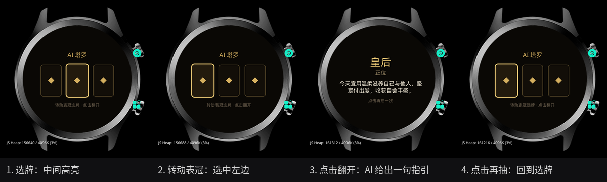
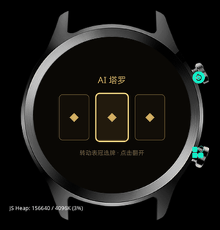
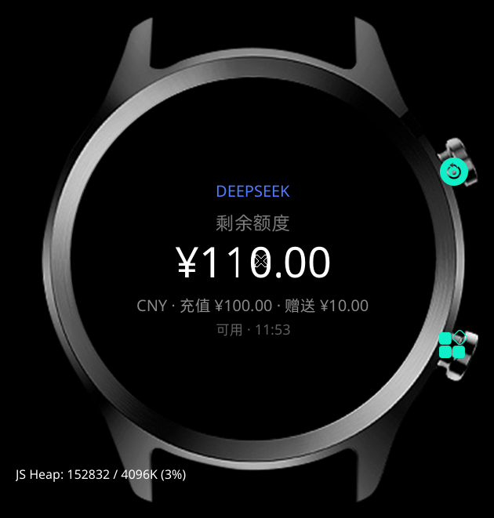

# OPPO Watch S 应用开发与侧载

-0a7ea4?style=flat-square)
-6b5a33?style=flat-square)


在 **OPPO Watch S（型号 OWW262，Glyphix OS，非安卓）** 上开发、构建并侧载第三方应用。

仓库里有一个完整可玩的肉鸽炮塔游戏、一个 AI 塔罗应用、一个 DeepSeek 余额查询应用，以及构建 / 安装 / 排错文档。

> ⚠️ 本项目基于对自有设备的互操作研究，**不包含任何厂商专有代码**。刷机、侧载有风险，后果自负。


> 真机 div 渲染实录：表冠瞄准、自动开火、升级三选一。早期 canvas 版概念演示见 [预览/旋钮炮塔/概念演示-canvas.gif](预览/旋钮炮塔/概念演示-canvas.gif)。

---

## 这台表是什么

| 项目 | 说明 |
|---|---|
| 型号 | OPPO Watch S（OWW262） |
| 屏幕 | 466 × 466 圆形 AMOLED |
| 系统 | **Glyphix OS**，RTOS 上的轻量 JS 应用框架，**不是 Android / Wear OS** |
| 应用格式 | `.rpk`（构建产物叫 `bundle.pkg`，改名即可） |
| 开发语言 | JavaScript + `.ux` 单文件组件（template / style / script） |
| 网络 | 无 Wi-Fi、无 eSIM，`@system.fetch` 经手机代理出网（实测可用） |
| 固件 | nucleus `0.7.0-44` / runtime `0.7.0-68` |

因此：

- ❌ 不能用 `adb install xxx.apk`
- ❌ 不能装 Wear OS 应用
- ✅ 用 `glyphix-cli`（`gx`）构建 `.rpk`
- ✅ 用手机端 **瑰元助手** 经 OPPO 健康的调试通道侧载

---

## 项目内容

| 应用 | 类型 | 说明 |
|---|---|---|
| [旋钮炮塔](应用/旋钮炮塔/) | 游戏 | 表冠瞄准 + 自动开火 + 双击大招的肉鸽塔防，10 关 + 无尽、5 种敌人、9 种升级、4 把武器、8 个成就 |
| [AI 塔罗](应用/AI塔罗/) | 应用 | 表冠选牌，DeepSeek 现场生成今日指引 |
| [DS 余额](应用/DS余额/) | 应用 | DeepSeek API 余额查询，大字号圆屏布局 |
| [二维码示例](应用/二维码示例/) | 示例 | 二维码展示（来自上游仓库） |
| [包名诊断](应用/包名诊断/) | 诊断 | 显示手表已安装包名，用于排查 |
| [清理工具](应用/清理工具/) | 工具 | 批量卸载侧载应用，恢复桌面入口 |
| [表盘实验](应用/表盘实验/) | 实验 | 表盘包（`type: dial`），可安装但系统表盘选择器不展示 |

预览：

| 旋钮炮塔 | AI 塔罗 |
|---|---|
|  |  |
|  |  |
|  |  |

---

## 方法来源与致谢

本项目的侧载方法、平台文档和部分工具来自这些作者。**没有他们，就没有这个仓库**：

| 来源 | 做了什么 | 许可 |
|---|---|---|
| [chengchengking/oppo-watch-s-sideload](https://github.com/chengchengking/oppo-watch-s-sideload) | 完整的 OWS 侧载工具链、`DEV_GUIDE`、协议逆向档案、`qrwatch`、`ows.py`、设备配置 | MIT |
| 班巴论坛教程作者 **libiao0418** | 最早的 OWS 侧载教程：瑰元助手 + PurrLaunch 路线 | — |
| **瑰元助手作者** | 手机端安装器，调试通道能装 rpk | 版权归作者，本仓库不分发 |
| [purrrock/PurrLaunch](https://github.com/purrrock/PurrLaunch) | 占位启动器，解决桌面入口 | MIT |
| [glyphix-os/web-docs](https://github.com/glyphix-os/web-docs) | Glyphix 官方框架 / 组件 / API 文档 | 官方文档 |

详细出处与核实日期见 [文档/上游资料/SOURCES.md](文档/上游资料/SOURCES.md)，许可证归属见 [NOTICE](NOTICE)。再次感谢以上作者。

---

## 快速开始

### 0. 你需要

- OPPO Watch S（OWW262）
- 一台**安卓手机**（装 OPPO 健康 + 瑰元助手，用蓝牙连手表）
- 电脑（Node.js 18+、Python 3、Android platform-tools）
- 数据线

### 1. 装构建工具

```bash
npm install -g glyphix-cli
gx --version   # v0.11.0 左右
```

### 2. 装设备配置

```bash
mkdir -p ~/.local/share/glyphix/devices
cp 设备配置/oppo-rtos-watch.yml ~/.local/share/glyphix/devices/
gx list device | grep oppo-rtos-watch
```

Windows 放到 `%APPDATA%\glyphix\devices\`。

### 3. 构建

```bash
cd 应用/旋钮炮塔
gx build -d oppo-rtos-watch -f
# 产物：.glyphix-work/dist/oppo-rtos-watch/com.rtos.turret2/bundle.pkg
```

### 4. 安装

1. 把 `bundle.pkg` 改名为 `xxx.rpk`
2. `adb push xxx.rpk /sdcard/Download/`
3. `adb shell am broadcast -a android.intent.action.MEDIA_SCANNER_SCAN_FILE -d file:///sdcard/Download/xxx.rpk`
4. 手机打开 **瑰元助手** → 连接 → 选 **OPPO 健康**
5. 安装应用 → 文件 → 下载 → 选 rpk
6. 日志出现 `安装应用 成功 {"code":200}` 即成功
7. **重启手表**（重要，见下方"关键坑"）

> 瑰元助手不随仓库分发（版权归其作者）。发布页：<https://www.pgyer.com/glyphix-assistant>

---

## 关键坑（务必先读）

完整版见 [文档/排错手册.md](文档/排错手册.md)。

1. **真机不支持 canvas**
   模拟器里 canvas 正常，真机上 `getContext('2d')` 拿不到可用上下文，画面全黑。
   本仓库的炮塔游戏因此改成了 **纯 div 渲染**（圆点/圆形元素 + 行内 left/top）。新应用请直接从 div 方案起步。

2. **行内 `border-radius` 不生效**
   `style="...border-radius:8px"` 在真机上报 `unknown style property: borderRadius` 并被忽略。
   解决：用 CSS 类写 `border-radius: 50%`，行内只放 left/top/width/height/background-color。

3. **行内 `border` 也不生效**
   同上。画圆环用"外层实心圆 + 内层背景色圆"两层拼。

4. **动态 class 绑定不可用**
   用 `if` 写两份静态 class 的元素切换，不要 `class="{{...}}"`。

5. **`transform: rotate()` 不可用**
   旋转元素要自己算坐标，或者用一串圆点模拟方向。

6. **触摸事件**
   - 只有**有实底色**的元素能命中触摸；透明层收不到。
   - 覆盖层用 `on:touchend`，`on:click` 在部分场景不触发。
   - canvas / div 的 `touchstart` / `touchend` 可用；透明层不行。
   - 层级冲突时，把点击同时挂在多层，用时间戳去重。

7. **表冠**
   - 旋转：`on:wheel`，事件字段只有 `deltaY`。
   - **真机的 deltaY 比模拟器大得多**，必须限幅（本项目为 `clamp(±1.5) * 0.02`）。
   - 按压：真机上报为 `Power` 键，`on:keydown` 能收到；用 `stopPropagation()` 可拦截系统默认返回。

8. **装完必须重启**
   侧载后桌面入口映射会临时错乱（点微信打开别的应用）。重启手表即可恢复；清理侧载应用也能恢复。

9. **覆盖商店应用会签名冲突**
   用调试通道覆盖 `com.xfaith.woodenfish`（敲木鱼）后，商店再装同包名会失败。想恢复：先卸载侧载包，再从商店装。

10. **升级要加 `versionCode`**
    覆盖安装时 `versionCode` 必须比已装的大。

11. **manifest 的 `icon` 必填**
    真机缺 icon 直接 `5005 invalid package`，模拟器却照跑。

---

## 目录结构

```
.
├── 应用/
│   ├── 旋钮炮塔/         # 肉鸽炮塔（完整源码）
│   ├── AI塔罗/           # AI 塔罗（含 build.sh 注入 key）
│   ├── DS余额/           # DeepSeek 余额（含 build.sh 注入 key）
│   ├── 二维码示例/       # 二维码（上游）
│   ├── 包名诊断/         # 显示已安装包名
│   ├── 清理工具/         # 批量卸载
│   └── 表盘实验/         # 表盘包实验
├── 文档/
│   ├── 构建与安装.md
│   ├── 排错手册.md
│   ├── 游戏设计.md
│   └── 上游资料/         # 上游逆向与平台文档（MIT，见致谢）
├── 设备配置/
│   └── oppo-rtos-watch.yml
├── 预览/
│   ├── 旋钮炮塔/         # 截图 / GIF / MP4
│   ├── AI塔罗/
│   └── DS余额/
├── 工具/
│   ├── ows.py            # 上游一键构建/推送
│   └── pkg_tool.py       # .pkg 容器读写
├── LICENSE
├── NOTICE
└── README.md
```

---

## 构建说明

见 [文档/构建与安装.md](文档/构建与安装.md)。

**API key 不会入库**：`aitarot` 和 `dsbalance` 的 `config.js` 里只有占位符，`build.sh` 从 `~/.config/dsbalance.key` 读取并注入，构建完自动还原源码。

```bash
printf '%s' 'sk-你的key' > ~/.config/dsbalance.key
chmod 600 ~/.config/dsbalance.key
cd 应用/DS余额 && ./build.sh
```

> 构建出的 rpk 内嵌 key，**不要分享或上传**。

---

## 致谢

完整的方法来源见上方 [方法来源与致谢](#方法来源与致谢)。核心上游：[chengchengking/oppo-watch-s-sideload](https://github.com/chengchengking/oppo-watch-s-sideload)、[purrrock/PurrLaunch](https://github.com/purrrock/PurrLaunch)、[glyphix-os/web-docs](https://github.com/glyphix-os/web-docs)、瑰元助手作者。各资源的许可证见 [NOTICE](NOTICE)。

---

## License

本项目原创部分（`turret2`、`aitarot`、`dsbalance`、`pkglist`、`cleanup`、`dsdial` 及本文档）采用 **MIT**，见 [LICENSE](LICENSE)。

上游资源遵循各自许可证，详见 [NOTICE](NOTICE)。
