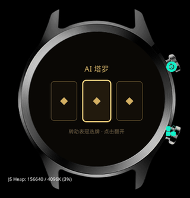

# AI 塔罗

手表上的每日塔罗：抽一张牌，DeepSeek 现场写一句今日指引。



## 玩法

1. 屏幕摆 3 张扣着的牌
2. **转表冠**左右选牌
3. **点一下**翻开
4. 显示牌名 / 正逆位 / AI 解读
5. 再点一下回到选牌

22 张大阿卡纳，正逆位随机。

## 配置 key

`src/main/config.js` 里只有占位符：

```js
apiKey: 'sk-REPLACE_ME'
```

构建时从本地文件注入：

```bash
printf '%s' 'sk-你的key' > ~/.config/dsbalance.key
chmod 600 ~/.config/dsbalance.key
./build.sh
```

`build.sh` 构建完会把源码还原，不会把 key 留在仓库里。

> 构建出的 rpk **内嵌 key**，不要分享。

## API

- `POST https://api.deepseek.com/chat/completions`
- 模型：`deepseek-chat`
- 每次约 120 max tokens
- 请求失败时用本地牌义兜底，不会白屏

## 构建

```bash
./build.sh
# 产物复制到仓库根目录的 aitarot.rpk
```

或手动：

```bash
gx build -d oppo-rtos-watch -f
```

## 文件

```
src/
├── app.js
├── manifest.json
├── assets/icon.png
└── main/
    ├── config.js     # API 地址 / key 占位符 / 模型
    ├── cards.js      # 22 张大阿卡纳 + 本地牌义
    └── index.ux      # 界面 + 表冠 + 请求
build.sh
```

## License

MIT
