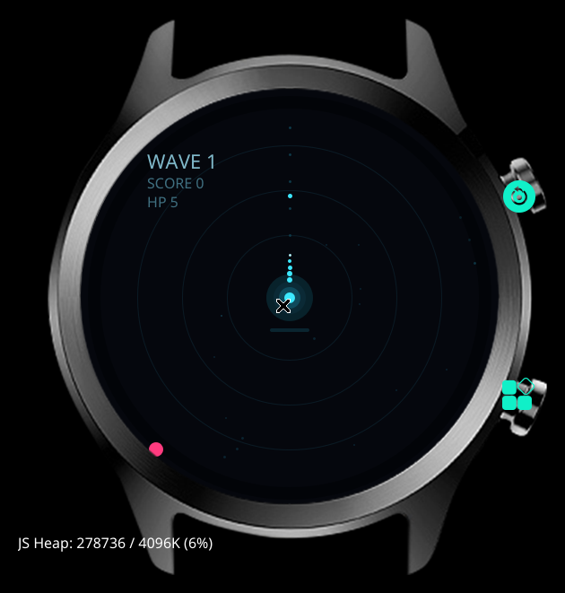

# 旋钮炮塔

为 OPPO Watch S 的圆屏和旋转表冠设计的肉鸽塔防。



## 玩法

- **转表冠瞄准**，炮塔自动开火
- 敌人从 360° 方向逼近，漏到中心扣血
- 清关后**三选一升级**（表冠选、点击确认）
- 第 5/10/15… 关是 Boss
- 第 10 关后进入无尽
- **双击屏幕放大招**（充能满时），也可以按表冠

## 功能

- 4 把武器：脉冲炮 / 散射炮 / 激光 / 导弹
- 5 种敌人 + Boss
- 9 种升级
- 8 个成就
- 本地存档（最高关数、总击杀、武器、成就）

## 构建

```bash
gx build -d oppo-rtos-watch -f
```

产物：`.glyphix-work/dist/oppo-rtos-watch/com.rtos.turret2/bundle.pkg`

无需 API key。

## 安装

见仓库根目录的 [构建与安装](../../文档/构建与安装.md)。装完**重启手表**。

## 文件

```
src/
├── app.js
├── manifest.json
├── assets/icon.png
└── main/index.ux     # 全部逻辑 + 渲染
```

## 技术说明

- **不使用 canvas**：真机不支持，全部用 div 渲染
- 动态元素由 `sprites` 数组每帧生成 `style` 字符串
- 圆角写在 CSS 类里（行内 `border-radius` 无效）
- 25fps（40ms tick），同屏数量有上限（见 [GAME_DESIGN](../../文档/游戏设计.md)）
- 表冠 `deltaY` 做了限幅：`clamp(±1.5) * 0.02`

## 已知问题

- 双击大招依赖 `touchend`，不同固件可能需要调整阈值（当前 480ms）
- 成就页暂未提供入口，数据仍在记录
- Boss 只做了基础行为，数值待调

## License

MIT
