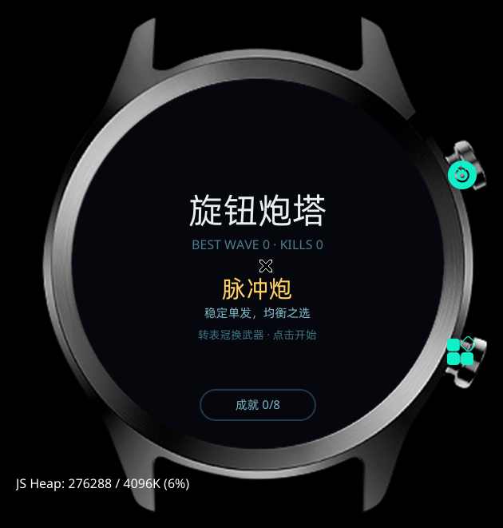

# DS 表盘（实验）

一个 Glyphix 表盘包（`type: dial`）：黑底 + 大号时间 + 日期 + DEEPSEEK。



## 结论（重要）

**能安装，但系统的表盘选择器不展示侧载表盘。**

- `bundle.pkg` 里 `type: "dial"`，`gx` 也把它当表盘包构建
- 瑰元助手可以安装成功
- 系统表盘列表只展示商店/系统签名的表盘

所以这个工程目前只能作为「表盘包格式」的参考，不能真正当表盘用。

## manifest

```json
{
  "package": "com.rtos.dsdial",
  "name": "DS表盘",
  "icon": "/assets/icon.png",
  "router": { "entry": "main", "pages": { "main": { "component": "index" } } },
  "dial": {
    "component": "main/index",
    "preview": "/assets/preview.png"
  },
  "config": { "designWidth": 466 }
}
```

- `dial.component`：表盘入口组件路径
- `dial.preview`：预览图
- 表盘包不使用 `icon` 字段（但为了兼容安装校验，这里保留了）

## 构建

```bash
gx build -d oppo-rtos-watch -f
```

产物 manifest 里 `type` 为 `dial`。

## 文件

```
src/
├── app.js
├── manifest.json
├── assets/
│   ├── icon.png
│   └── preview.png    # 466×466 预览图
└── main/index.ux      # 时间 + 日期
```

## 后续

如果后续固件开放侧载表盘，或找到注册表写入方式，这个工程可以直接用。
