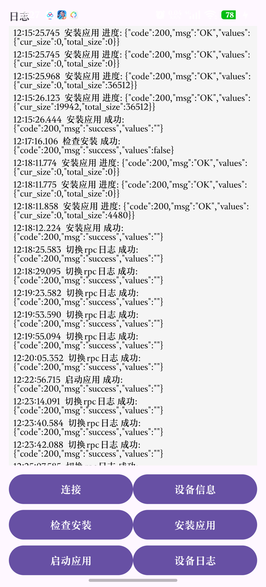
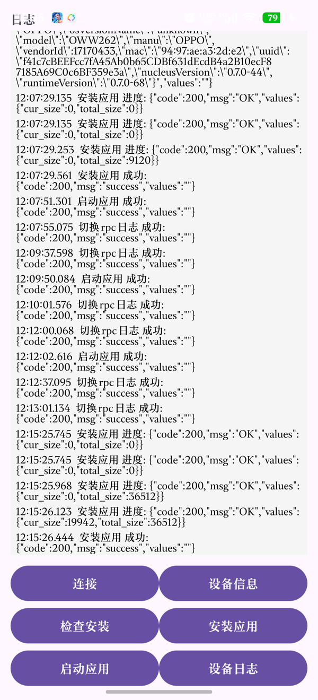

# 构建与安装

## 环境

| 工具 | 版本 | 说明 |
|---|---|---|
| Node.js | 18+ | 跑 `glyphix-cli` |
| Python | 3.8+ | 跑注入脚本 / `pkg_tool.py` |
| Android platform-tools | 任意 | `adb`，用于把 rpk 推到手机 |
| 安卓手机 | — | 装 OPPO 健康 + 瑰元助手 |
| 数据线 | — | 手机连电脑，开 USB 调试 |

```bash
npm install -g glyphix-cli
gx --version
# gx v0.11.0
```

## 设备配置

`gx` 需要知道目标屏幕参数。把 `设备配置/oppo-rtos-watch.yml` 复制到 gx 的数据目录：

```bash
gx list path
# data=/home/<user>/.local/share/glyphix:...

mkdir -p ~/.local/share/glyphix/devices
cp 设备配置/oppo-rtos-watch.yml ~/.local/share/glyphix/devices/

gx list device | grep oppo-rtos-watch
```

Windows：

```powershell
copy 设备配置\oppo-rtos-watch.yml %APPDATA%\glyphix\devices\
```

配置内容：

```yaml
description: OPPO Watch S (OWW262) 466x466 circle AMOLED
vendorID: 0x0000
productID: 0x0000
screen:
  width: 466
  height: 466
  dpi: 326
  shape: circle
ui:
  font-family: sans-serif
  font-size: 32
  font-map: true
emulator:
  launcher: launcher
  global-assets: default-global
  surface: surface/surface-466x466.json
```

> `vendorID` / `productID` 必须是 `0x0000/0x0000`。改成探针用的其他值会导致包在真机上报 `5005`。

## 构建

```bash
cd 游戏/旋钮炮塔
gx build -d oppo-rtos-watch -f
```

- `-d` 目标设备
- `-f` 全量构建（改过设备配置后必须加）

产物：

```
.glyphix-work/dist/oppo-rtos-watch/<包名>/
├── bundle.pkg      # 安装包（改名 .rpk）
├── icon.png
└── manifest.json
```

侧载只需要 `bundle.pkg`。

## 模拟器

```bash
cd 游戏/旋钮炮塔
gx emu -d oppo-rtos-watch --target com.rtos.turret2
```

- **鼠标滚轮 = 表冠**（`on:wheel`）
- **左键 = 触摸**
- 模拟器支持 canvas，但真机不支持；新应用请按 div 渲染写

无桌面环境时可以跑在 Xvfb 里截图：

```bash
Xvfb :99 -screen 0 1280x1024x24 &
DISPLAY=:99 QT_QPA_PLATFORM=xcb gx emu -d oppo-rtos-watch --target com.rtos.turret2
ffmpeg -f x11grab -video_size 1280x1024 -i :99 -frames:v 1 shot.png
```

## 安装（侧载）

### 1. 推到手机

```bash
cp .glyphix-work/dist/oppo-rtos-watch/com.rtos.turret2/bundle.pkg turret2.rpk
adb push turret2.rpk /sdcard/Download/
adb shell am broadcast -a android.intent.action.MEDIA_SCANNER_SCAN_FILE \
  -d file:///sdcard/Download/turret2.rpk
```

> 最后一步触发媒体扫描，否则瑰元助手的"下载"里看不到文件。
> Windows Git Bash 请先 `export MSYS_NO_PATHCONV=1`。

### 2. 手机准备

1. 手机开启开发者选项 → **USB 调试**，数据线连电脑，手机上点「允许」
2. `adb devices` 能看到设备
3. 装 **瑰元助手**（`com.glyphix.assistant`，**v1.2 验证通过，v1.3 未回归**）
4. 首次打开会要求「所有文件访问权限」→ 允许（否则读不到 Download 里的 rpk）
5. OPPO 健康已和手表配对，手机蓝牙开启

### 3. 手机端安装

1. 打开 **瑰元助手**
2. 点「连接」→ 选 **OPPO 健康**（`com.heytap.health`）
3. 日志出现 `连接成功`
4. 点「安装应用」→ 进入文件选择器
5. **注意：选择器默认停在「最近」的图片列表**，先点顶部标题「最近」→ 切到「文件」→ 再搜索 rpk 文件名（例如 `turret2`）
6. 选中后等待传输，日志出现 `安装应用 成功 {"code":200}`

> 如果误选了图片，会报 `5005 invalid package`。返回重选即可，不是包的问题。

### 安装界面参考

助手主界面（六个按钮）：



安装成功日志（`安装应用 成功 {"code":200}`）：



### 4. 重启手表

**每次侧载后都要重启。** 不重启会出现桌面入口错乱（点微信打开别的应用）。

## 连接不上手表？

- 手表深睡会断开蓝牙：抬腕点亮屏幕，再在瑰元助手点「连接」
- 手机锁屏时，部分系统会冻结助手 Activity：保持亮屏
- 日志一直停在「查询到 1 个服务」：确认 OPPO 健康在前台运行过、蓝牙已开

## 升级

改 `src/manifest.json`：

```json
{
  "versionName": "2.0.2",
  "versionCode": 6
}
```

`versionCode` 必须比已装的大，否则覆盖安装可能失败。

## API key 注入

`aitarot` 和 `dsbalance` 不把 key 写进源码：

```bash
printf '%s' 'sk-你的key' > ~/.config/dsbalance.key
chmod 600 ~/.config/dsbalance.key

cd 应用/DS余额 && ./build.sh
```

`build.sh` 会：

1. 从 `~/.config/dsbalance.key` 读 key
2. 临时替换 `src/main/config.js` 里的 `apiKey`
3. 构建
4. 还原源码（`trap`）

构建出的 rpk **内嵌 key**，不要上传或分享。

## 一键脚本（可选）

`工具/ows.py` 来自上游仓库，封装了「构建 + push + 媒体扫描」：

```bash
python 工具/ows.py doctor
python 工具/ows.py install <app>
```

注意：它的路径假设基于上游仓库结构，在本仓库使用前请按实际情况调整，或直接照上面的手动流程。

---

## 方法来源

本项目的侧载路线来自以下作者，详见仓库根目录 [README](../README.md#方法来源与致谢) 与 [NOTICE](../NOTICE)：

- **chengchengking/oppo-watch-s-sideload**（MIT）—— 工具链、`DEV_GUIDE`、逆向档案、`ows.py`、设备配置
- **班巴论坛教程作者 libiao0418** —— OWS 侧载教程（瑰元助手 + PurrLaunch）
- **瑰元助手作者** —— 手机端安装器（本仓库不分发 APK）
- **purrrock/PurrLaunch**（MIT）—— 占位启动器
- **glyphix-os/web-docs** —— 官方框架文档
