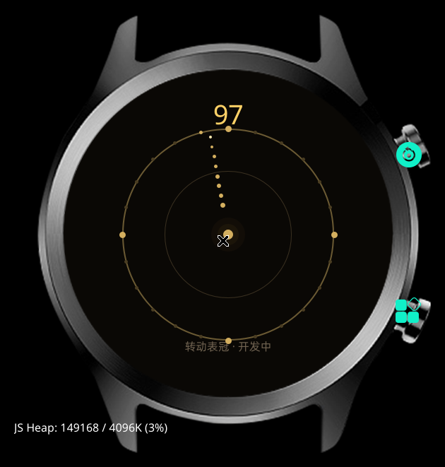

# 保险柜（开发中）

用 **表冠当保险柜转轴**：来回扭，找到密码位，开锁。

## 概念

- 保险柜有 **3 组密码**
- 每组密码是一个刻度位（0~99）
- 转动表冠，转盘跟着转；接近正确刻度时会有"咔哒"反馈
- 停在正确位置，点击确认；3 组全对即开锁
- 找错位会触发警报 / 损失一次机会

## 当前版本 v0.1

先验证最关键的 **表冠手感**：

- 转动表冠，指针和数字跟随
- 24 个刻度，接近当前角度时高亮
- 还没有密码与判定逻辑



## 操作

| 输入 | 作用 |
|---|---|
| 转表冠 | 转动保险柜转盘 |
| 点击屏幕 | 确认当前刻度（待实现） |

## 下一步

- [ ] 生成 3 组随机密码
- [ ] 刻度判定（±2 以内算对）
- [ ] 接近正确刻度时的"咔哒"视觉反馈
- [ ] 错误警报 / 重来
- [ ] 难度：假刻度、时间限制、锁定范围收紧
- [ ] 开锁动画

## 构建

```bash
cd 游戏/保险柜
gx build -d oppo-rtos-watch -f
# 产物：.glyphix-work/dist/oppo-rtos-watch/com.rtos.safecrack/bundle.pkg
```

安装流程见 [文档/构建与安装.md](../../文档/构建与安装.md)。

## 技术

- 纯 div 渲染（真机不支持 canvas）
- 表冠 `on:wheel`，`deltaY` 限幅 `clamp(±1.5) * 0.02`
- 25fps（40ms tick）
- 圆角写在 CSS 类里

## License

MIT
