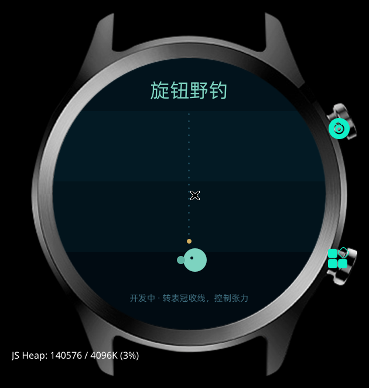

# 旋钮野钓（开发中）

用 **表冠当收线轮**：转快了断线，转慢了脱钩，要在张力里把鱼遛上来。

## 概念

- 鱼上钩后，表冠控制收线速度
- 鱼会周期性挣扎，张力条跟着涨
- 张力过高 → 断线；收线太慢 → 鱼脱钩
- 把鱼遛到岸边即成功，结算鱼种 / 重量
- 水域从溪流到深潭，鱼种和挣扎节奏不同

## 当前版本 v0.1

静态占位：水面分层、鱼线、浮标、鱼影，先把视觉方向定下来。



## 操作（规划）

| 输入 | 作用 |
|---|---|
| 转表冠 | 收线，转动速度 = 收线速度 |
| 点击屏幕 | 提竿 / 确认 |

## 下一步

- [ ] 张力条与收线进度
- [ ] 鱼挣扎的节奏曲线
- [ ] 断线 / 脱钩判定
- [ ] 鱼种与重量
- [ ] 上钩结算
- [ ] 不同水域

## 构建

```bash
cd 游戏/旋钮野钓
gx build -d oppo-rtos-watch -f
# 产物：.glyphix-work/dist/oppo-rtos-watch/com.rtos.knobfishing/bundle.pkg
```

安装流程见 [文档/构建与安装.md](../../文档/构建与安装.md)。

## 技术

- 纯 div 渲染（真机不支持 canvas）
- 表冠 `on:wheel`，`deltaY` 需限幅
- 圆角写在 CSS 类里

## License

MIT
